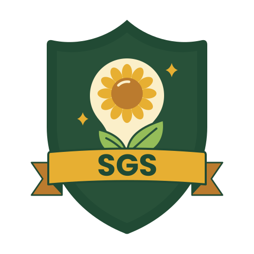

# Smart Garden School logo

The garden logo keeps the school's recognizable shield, lightbulb/sunflower, growing leaves and SGS ribbon. Rounded contours and warm garden colors connect it to the picture-book artwork across the website and platform.

`logo.svg` is a native SVG with a transparent background and a `0 0 500 500` viewBox. SGS lettering is outlined vector geometry, so rendering does not depend on installed fonts. Keep the full square canvas, preserve the 1:1 aspect ratio and do not crop the mark.

| Role | Color |
| --- | --- |
| Forest shield | `#285139` |
| Dark green outlines and details | `#214a34` |
| Leaves | `#95bd59` |
| Honey petals and ribbon | `#e7af32` |
| Cream lightbulb and petal highlight | `#fbefc9` |
| Ochre ribbon folds | `#bb7b2e` |

The website's header, footer, about section, favicon and logo demo reference `logo.svg?v=garden-2` to avoid reusing the previous mark from browser cache. Change this version when replacing the artwork. The platform keeps matching copies at `public/logo.svg` and `src/app/icon.svg`. Update all three SVG files together when changing the shared mark.

Use explicit matching width and height attributes in image markup to reserve layout space:

```html

```
